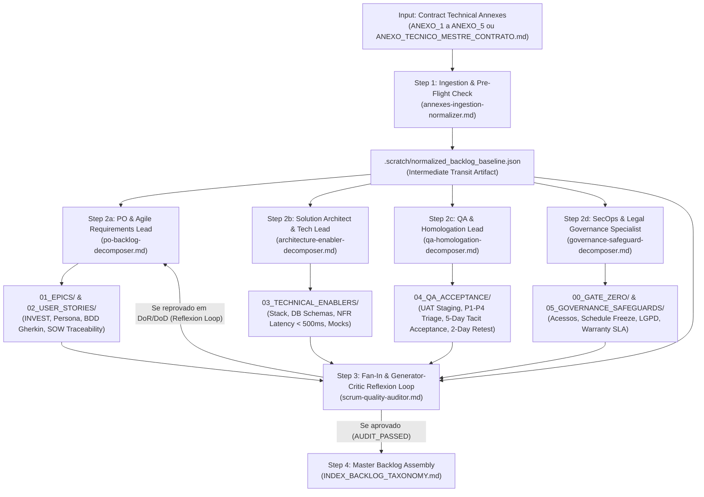

<div align="center">

# Contract Scrum Cards Engine Plugin
### Global Multi-Agent Engineering Pipeline for Contract-to-Agile Backlog Decomposition

[](https://antigravity.google)
[](#4-multi-agent-orchestration-architecture--comparative-justification)
[](./LICENSE)
[](#3-granular-hierarchy--directory-partitioning)

<p align="center">
  <b>Transform binding contract technical annexes (SOW, RACI, Homologation, CR, and SLA) into an enterprise-grade, auditable Scrum/Agile backlog with granular Markdown cards, strict Definition of Ready (DoR), Definition of Done (DoD), and 100% bidirectional contractual traceability.</b>
</p>

</div>

---

## 1. Overview & Strategic Mission

The **Contract Scrum Cards Engine Plugin** (`contract-scrum-cards-engine`, v1.0.0) is an enterprise-grade agentic customization for Google Antigravity. It resolves one of the most critical friction points in modern software engineering: **the gap between legal-contractual commitments and day-to-day agile execution**.

In standard industry workflows, technical proposals and contract annexes (SOW, RACI, Homologation protocols) are negotiated by legal, commercial, and architecture teams, but the resulting sprint backlogs are manually written by developers or product owners who often miss critical legal safeguards, omit conditioning premises, create vague acceptance criteria, or inflate monolithic documents.

By ingesting the binding contract technical annexes produced by upstream engines (specifically the `contract-technical-annexes-engine-plugin` or compliant SOW, RACI, Homologation, CR, and SLA documents), this plugin orchestrates a specialized multi-agent pipeline governed by a native **Skill Orchestrator** (`skills/contract-scrum-orchestrator/SKILL.md`). The pipeline decomposes contractual obligations into **granular, self-contained Markdown cards** organized into a clean physical hierarchy, ensuring that:
1. Every dollar contracted corresponds to an auditable engineering deliverable (**Zero Scope Leakage**).
2. No out-of-scope features are inadvertently introduced into the squad's sprint (**Zero Scope Creep / Anti-Gold-Plating**).
3. Every card is governed by strict, unambiguous **Definition of Ready (DoR)** and **Definition of Done (DoD)** rubrics.
4. All contract safeguards (Gate Zero, 16-hour Schedule Freeze, 5-day Tacit Acceptance, 2-day Retest Window, P1–P4 triage, LGPD synthetic data, and 60-day Warranty) are embedded directly into operational cards.

---

## 2. Critical Negative Constraints & Architectural Invariants

> [!CAUTION]
> **STRICT NEGATIVE CONSTRAINTS & INVARIANTS**  
> 1. **Zero Monolith Tolerance (Anti-Bloat):** The engine is **strictly prohibited** from outputting the backlog into a single massive, bloated markdown file. Each Epic, User Story, Technical Enabler, QA Homologation Plan, and Governance Safeguard must reside in its own dedicated `.md` file inside structured subdirectories.
> 2. **Zero Scope Leakage Invariant:** 100% of the substantive deliverables, NFRs, conditioning premises, and RACI milestones in the contract must map to at least one card in the backlog.
> 3. **Zero Scope Creep Invariant (Anti-Gold-Plating):** No agent may invent features, alter business rules, or add capabilities not explicitly grounded in the contract annexes. Any non-contractual scope must be flagged and isolated as a candidate for Anexo 4 (Change Request).
> 4. **Anti-Vagueness Invariant:** Stories and acceptance criteria must never contain subjective qualifiers ("user-friendly", "fast", "intuitive", "optimize"). All criteria must follow formal BDD/Gherkin syntax with testable assertions.
> 5. **Output Hygiene:** Generated markdown cards must have all HTML template comments (`<!-- ... -->`) completely stripped, and zero unresolved placeholders (`{{...}}`) may remain in the final deliverables.

---

## 3. Granular Hierarchy & Directory Partitioning

To avoid file bloat and facilitate seamless import into project management tools (Jira, GitHub Projects, Linear, Azure DevOps), the backlog is partitioned into 6 specialized directories plus the Master Index:

```
backlog/
├── INDEX_BACKLOG_TAXONOMY.md              # Executive Dashboard, Synoptic Table & Traceability Matrix
├── 00_GATE_ZERO/                          # Pre-requisite cards blocking milestone start
│   ├── GZ-001-LIBERACAO-ACESSOS-AMBIENTES.md
│   └── GZ-002-SETUP-CI-CD-MOCK-SANDBOX.md
├── 01_EPICS/                              # Milestone & Value Stream Epics
│   ├── EPIC-01-FUNDACAO-ARQUITETURAL.md
│   └── EPIC-02-[NOME_DO_MODULO].md
├── 02_USER_STORIES/                       # Atomic functional user stories (INVEST, BDD, DoR/DoD)
│   ├── US-0101-[NOME_DA_HISTORIA].md
│   └── US-0102-[NOME_DA_HISTORIA].md
├── 03_TECHNICAL_ENABLERS/                 # Spikes, DB Migrations, OpenAPI specs, Mocks, CI/CD
│   ├── ENABLER-0101-INTEGRACAO-API-LATENCIA.md
│   └── ENABLER-0102-MIGRATION-SCHEMA-BANCO.md
├── 04_QA_ACCEPTANCE/                      # Staging UAT Plans, P1-P4 Triage, 5-day Tacit Acceptance
│   ├── QA-0101-PLANO-HOMOLOGACAO-STAGING.md
│   └── QA-0102-SUITE-MOCK-RESILIENCIA-LEGADO.md
└── 05_GOVERNANCE_SAFEGUARDS/              # LGPD compliance, Schedule Freeze monitor, SLA Warranty
    ├── GOV-001-CONFORMIDADE-LGPD-DADOS-SINTETICOS.md
    ├── GOV-002-MONITORAMENTO-SLA-RESPOSTA-FREEZE.md
    ├── GOV-003-GOVERNANCA-CHANGE-REQUESTS.md
    └── GOV-004-RITO-GARANTIA-SUPORTE-SLA.md
```

---

## 4. Multi-Agent Orchestration Architecture & Comparative Justification

### 4.1 Orchestration Model Choice: Why Staged Multi-Agent DAG with Fan-Out/Fan-In & Generator-Critic (Reflexion)?

When designing an autonomous agentic pipeline for decomposing dense legal-technical contracts into engineering backlogs, several orchestration architectures can be evaluated:

| Orchestration Architecture | Suitability | Why it was selected or rejected |
| :--- | :---: | :--- |
| **Single-Agent Monolítico com Progressive Disclosure** | ❌ Rejeitado | Falha por diluição de contexto, viés de recência e esgotamento de janela de saída. Um único agente gerando dezenas de cards granulares em múltiplos subdiretórios invariavelmente resume seções, omite critérios de aceite BDD ou produz arquivos inchados. |
| **Router / Triagem On-Demand** | ❌ Rejeitado | Adequado para despachar requisições mutuamente exclusivas (ex: suporte ao cliente, onde cada ticket vai para um departamento). No caso de decomposição contratual, **todos os domínios precisam ser executados de forma coordenada e simultânea** sobre a mesma base contratual. |
| **Comitê de Debate (Swarm / Multi-Agent Debate)** | ❌ Rejeitado | Altamente custoso em tokens e de natureza estocástica e divergente. O backlog derivado de contrato exige **conformidade determinística e fidelidade literal às cláusulas pactuadas**, não consenso negociado aberto. |
| **Hierarquia Multinível Pura (Manager-Worker)** | ⚠️ Parcial | Fornece subordinação clara, mas sem as barreiras formais de estágio (DAG) e sem o loop de crítica e reflexão sobre conformidade normativa de DoR/DoD. |
| **Staged Multi-Agent Pipeline com Contextual Handoff (DAG) integrado com Fan-Out/Fan-In e Generator-Critic (Reflexion)** | ✅ **ESCOLHIDO (Arquitetura Ótima)** | **A mais adequada para o problema.** O processamento é dividido em 4 estágios determinísticos: Ingestão Sequencial, Fan-Out Especializado Paralelo, Fan-In com Barreira de Qualidade (Generator-Critic) e Handoff Mestre. |

### 4.2 The 4 Stages of the Pipeline



1. **Stage 1 — Ingestion & Pre-Flight Normalization (Sequential):**  
   The `annexes-ingestion-normalizer` parses the contract documents, validates preconditions (halting on missing core functional scope or technical stack), injects smart software house defaults if secondary parameters are absent, and writes the structured `.scratch/normalized_backlog_baseline.json`.
2. **Stage 2 — Domain Specialist Decomposition (Parallel Fan-Out):**  
   Four dedicated agents, each an expert in their respective domain, operate concurrently using specialized templates:
   - `po-backlog-decomposer`: Focuses on user personas, substantive functional scope, BDD scenarios, and INVEST slicing (`01_EPICS/`, `02_USER_STORIES/`).
   - `architecture-enabler-decomposer`: Focuses on technical foundation, API contracts, NFR latency (< 500ms p95), database schemas, and CI/CD mock harnesses (`03_TECHNICAL_ENABLERS/`).
   - `qa-homologation-decomposer`: Focuses on UAT staging plans, the 5-point defect evidence rubric, P1–P4 severity triage, 5-day Tacit Acceptance, and 2-day retest window (`04_QA_ACCEPTANCE/`).
   - `governance-safeguard-decomposer`: Focuses on Gate Zero environment clearances, RACI operational cadence, 16-hour client response monitoring, Schedule Freeze triggers, LGPD non-prod data rules, and 60-day technical warranty runbooks (`00_GATE_ZERO/`, `05_GOVERNANCE_SAFEGUARDS/`).
3. **Stage 3 — Cross-Audit & Quality Gate (Fan-In with Generator-Critic Reflexion):**  
   The `scrum-quality-auditor` ingests all generated cards and validates them against the 6-point audit rubric: Contract Coverage (Zero Scope Leakage), Anti-Gold-Plating (Zero Scope Creep), DoR conformance, DoD conformance, Granularity limits (<= 8 SP per story), and Output Hygiene. If any card fails, a targeted Reflexion correction is triggered.
4. **Stage 4 — Master Backlog Assembly & Handoff:**  
   Once the audit passes (`AUDIT_PASSED`), the auditor compiles the master `INDEX_BACKLOG_TAXONOMY.md`, containing the Executive Synoptic Governance Table, aggregated story point metrics, and the bidirectional traceability matrix.

---

## 5. Normative Standards: Definition of Ready (DoR) & Definition of Done (DoD)

### 5.1 Definition of Ready (DoR) — 8 Pillars
Governed by `rules/definition-of-ready-standard.md`. A card cannot be pulled into an active sprint unless it fulfills all 8 criteria:
1. **Contract Clause Anchoring:** Explicit traceability tag (e.g., `[ANEXO_1_SOW-SEC-3.1]`).
2. **Substantive Persona & Narrative:** Canonical framing (`Como... Quero... Para que...`) with substantive nouns and zero vague verbs.
3. **BDD / Gherkin Criteria:** Minimum of 2 structured scenarios (at least 1 Happy Path and 1 Edge Case/Exception).
4. **Technical Prerequisites:** OpenAPI endpoints, database schemas, and external sandboxes identified.
5. **Negative Scope (Boundaries):** Explicit list of out-of-scope aspects for the card.
6. **Bilateral RACI Ownership:** Designated Client PO as approver and squad lead as assignee.
7. **INVEST Granularity Sizing:** Estimated in Fibonacci points (1, 2, 3, 5, 8). Stories > 8 SP must be split.
8. **Gate Zero Prerequisite Clearance:** Confirms that Gate Zero preconditions are satisfied.

### 5.2 Definition of Done (DoD) — 8 Criteria
Governed by `rules/definition-of-done-standard.md`. A card cannot be closed as `DONE` or submitted for homologation without:
1. **Code Quality & Static Analysis:** Zero critical/high security flaws and linters passing in CI.
2. **Automated Test Coverage:** Minimum of 80% unit test coverage and automated integration/API tests passing.
3. **NFR Latency & Concurrency:** p95 latency < 500ms verified under simulated load.
4. **LGPD Compliance:** Staging/Dev strictly populated with synthetic or anonymized data; zero real production PII.
5. **Staging Deployment:** Successfully deployed to Staging via automated CI/CD with healthy endpoints.
6. **API Contracts & Documentation:** OpenAPI/Swagger specification updated, and release note drafted.
7. **Peer Review:** Pull Request approved by at least one Tech Lead or Senior Engineer.
8. **Homologation Readiness (Anexo 3):** Test evidence package generated, triggering the 5-day Tacit Acceptance clock with the Client PO.

---

## 6. Directory Structure (Antigravity Plugin Compliant)

```
contract-scrum-cards-engine-plugin/
├── plugin.json                                         # Plugin manifest (Antigravity v1 schema)
├── README.md                                           # Comprehensive documentation
├── LICENSE                                             # MIT License
├── .gitignore                                          # VCS ignores (.scratch, logs, output)
├── rules/
│   ├── definition-of-ready-standard.md                 # DoR normative standard (8 pillars)
│   ├── definition-of-done-standard.md                  # DoD normative standard (8 criteria)
│   └── contract-to-scrum-traceability.md               # Traceability & taxonomy rules
├── skills/
│   └── contract-scrum-orchestrator/
│       ├── SKILL.md                                    # Skill definition & DAG orchestration
│       ├── scripts/
│       │   └── validate_backlog.py                     # Deterministic automated backlog validator
│       └── templates/
│           ├── EPIC.template.md                        # Milestone & Epic card template
│           ├── USER_STORY.template.md                  # User Story card template
│           ├── TECHNICAL_ENABLER.template.md           # Enabler & Spike card template
│           ├── QA_HOMOLOGATION.template.md             # UAT & Homologation card template
│           ├── GATE_ZERO_SAFEGUARD.template.md         # Gate Zero & Safeguard card template
│           └── INDEX_BACKLOG_TAXONOMY.template.md      # Master Backlog Index template
├── agents/
│   ├── annexes-ingestion-normalizer.md                 # Normalization & Pre-flight agent
│   ├── po-backlog-decomposer.md                        # Functional Epic & Story agent
│   ├── architecture-enabler-decomposer.md              # Technical Enabler & NFR agent
│   ├── qa-homologation-decomposer.md                   # UAT & Acceptance agent
│   ├── governance-safeguard-decomposer.md              # Gate Zero, LGPD & SLA agent
│   └── scrum-quality-auditor.md                        # Fan-In Auditor & Compiler agent
└── tests/
    ├── test_plugin_integrity.py                        # Plugin manifest, agents, rules & templates test suite
    └── test_e2e_backlog_generation.py                  # End-to-end generation, INVEST & DoR/DoD audit test suite
```

---

## 7. Invocation & Usage Guide

### 7.1 Direct Slash Command
Execute directly from the Antigravity prompt:

```bash
/contract-scrum-orchestrator [caminho_dos_anexos] [diretorio_saida]
```

**Examples:**
- Using the consolidated master contract:
  ```bash
  /contract-scrum-orchestrator ./anexos_contratuais/ANEXO_TECNICO_MESTRE_CONTRATO.md ./backlog
  ```
- Using a directory of individual annexes:
  ```bash
  /contract-scrum-orchestrator ./anexos_contratuais ./backlog
  ```

### 7.2 Contextual Natural Language Invocations
The skill automatically activates upon requests such as:
- *"Decomponha os anexos contratuais do projeto em cards ágeis em markdown organizados por pastas."*
- *"Crie o backlog de Jira e histórias de usuário a partir do SOW e do protocolo de homologação com DoR e DoD."*
- *"Gere os cards de épicos, enablers de arquitetura, QA e salvaguardas de Gate Zero para este contrato."*

### 7.3 Deterministic Backlog Validation CLI & Test Suite
The plugin includes an automated, deterministic verification tool to audit any generated backlog for structural integrity, DoR/DoD conformance, INVEST limits, and bidirectional traceability:

```bash
# Deterministically audit a generated backlog directory
python3 skills/contract-scrum-orchestrator/scripts/validate_backlog.py ./backlog

# Run the full automated test suite (unittest discovery)
python3 -m unittest discover -s tests -p "test_*.py" -v
```

---

## 8. Upstream & Downstream Ecosystem Integration

This plugin is part of the integrated enterprise engineering suite maintained by HalcyonTech:

1. **Upstream: `contract-technical-annexes-engine-plugin`**  
   Produces the 5 binding contract technical annexes (`ANEXO_1_SOW.md` through `ANEXO_5_GARANTIA_SLA.md`) and `ANEXO_TECNICO_MESTRE_CONTRATO.md` from discovery dossiers.
2. **Current: `contract-scrum-cards-engine-plugin`**  
   Consumes those technical annexes and transforms them into an actionable, granular Scrum backlog in Markdown with full contractual traceability, DoR, and DoD.
3. **Downstream: `technical-delivery-engine-plugin`**  
   Consumes sprint results and backlog artifacts to generate C4 Model architecture diagrams, automated release notes, QA execution logs, and formal Handover/Encerramento terms.

---

## 9. License

This project is licensed under the terms of the [MIT License](./LICENSE).  
Copyright (c) 2026 HalcyonTech LTDA.


---

## 💡 Prompt Recipes & Use Cases

```markdown
- Execute /contract-scrum-orchestrator para decompor os anexos técnicos contratuais em cards ágeis granulares em markdown
- Transforme o ANEXO_TECNICO_MESTRE_CONTRATO.md em backlog ágil com épicos, histórias BDD, enablers, QA e salvaguardas
- Decomponha o SOW e anexos em histórias de usuário INVEST (máx 8 SP) com DoR e DoD normativos
- Audite o backlog ágil com o scrum-quality-auditor e gere a matriz de rastreabilidade bidirecional
```
